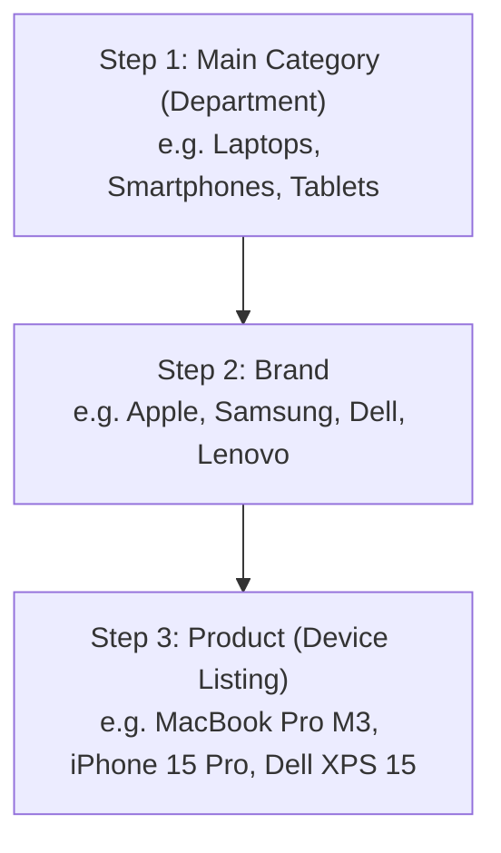

# 🛒 Buy-Phones Admin Panel — Easy Team Management Manual
> **A Step-by-Step, Layman's Guide for Store Managers, Warehouse Staff & Sales Team**  
> **Admin Link:** `https://sellphone.ae/admin/buy-phones` *(or `http://localhost:3000/admin/buy-phones`)*  
> **Customer Storefront:** `https://sellphone.ae/buy-phones`  
> **Version:** 3.0 (Hierarchical Architecture Update)

---

## 📌 Table of Contents
1. [What is the Buy-Phones Store & How Does It Work?](#1-what-is-the-buy-phones-store--how-does-it-work)
2. [How the 3-Step Store Hierarchy Works (Very Important!)](#2-how-the-3-step-store-hierarchy-works-very-important)
3. [Logging into the Admin Panel](#3-logging-into-the-admin-panel)
4. [Tour of the 5 Admin Tabs](#4-tour-of-the-5-admin-tabs)
5. [How to Manage Main Categories (Tab 2)](#5-how-to-manage-main-categories-tab-2)
6. [How to Manage Brands & Assign Them to Categories (Tab 3)](#6-how-to-manage-brands--assign-them-to-categories-tab-3)
7. [How to Add & Edit Devices for Sale (Tab 1)](#7-how-to-add--edit-devices-for-sale-tab-1)
8. [How to Handle Customer Orders & Doorstep Deliveries (Tab 4)](#8-how-to-handle-customer-orders--doorstep-deliveries-tab-4)
9. [Real-World Examples (Follow Along Step-by-Step)](#9-real-world-examples-follow-along-step-by-step)
   - [Example A: Adding a Brand-New Department (Gaming) & a PS5 Console](#example-a-adding-a-brand-new-department-gaming--a-ps5-console)
   - [Example B: Adding a Refurbished MacBook Pro M3 Laptop](#example-b-adding-a-refurbished-macbook-pro-m3-laptop)
   - [Example C: Handling a Customer Order from Start to Finish](#example-c-handling-a-customer-order-from-start-to-finish)
10. [Daily Staff Checklist & Do's and Don'ts](#10-daily-staff-checklist--dos-and-donts)
11. [Frequently Asked Questions (FAQs)](#11-frequently-asked-questions-faqs)

---

## 1. What is the Buy-Phones Store & How Does It Work?

**SellPhone24** has two sides:
1. **Sell Phones Side (`/`)**: Where customers bring their used phones to get cash from us.
2. **Buy Phones Side (`/buy-phones`)**: Our online retail shop where customers purchase certified, inspected, pre-owned devices (phones, laptops, tablets, watches) with a **12-month store warranty** and **Cash or Card on Delivery**.

### Your Team's Job in this Panel:
- Put new inspected devices up for sale with good photos and fair prices.
- Organize items into the correct departments (Smartphones, Laptops, Tablets, etc.).
- When orders come in, verify them, pack them with the warranty card, and send them with the driver for delivery.

---

## 2. How the 3-Step Store Hierarchy Works (Very Important!)

Everything in our store follows a clean **3-Step Ladder**. When you add anything to the store, always remember this sequence:



### Why is this important?
- If you add **Dell**, you link it to **Laptops**. It will never show up by mistake under phones!
- If you add **Apple**, you can link it to **Smartphones**, **Laptops**, **Tablets**, and **Smartwatches**.
- When you create a product and choose `Laptops`, the brand dropdown **only** shows laptop brands. It makes your job fast and eliminates mistakes.

---

## 3. Logging into the Admin Panel

1. Open your browser and go to:  
   👉 **`https://sellphone.ae/admin/buy-phones`**
2. You will see a Clerk login screen. Sign in using your approved team email:
   - `sellphone24phone@gmail.com`
   - `mesouq2@gmail.com`
   - `admin@sellyourphone24.com`
   - `shantanukamble.org@gmail.com`
   - `ibrahimmwn2012@gmail.com`
3. If you see the message **"Access Restricted"**, it means your logged-in Google/Clerk account is not on the admin list. Click **Sign Out** and log in with your official company email.

---

## 4. Tour of the 5 Admin Tabs

At the top of the dashboard, you will see **5 colored tabs**:

| Tab Name | Icon | What it is used for |
| :--- | :---: | :--- |
| **1. Certified Catalog** | 📦 | See all phones/laptops in stock, change prices, update stock, and click **`+ Add Certified Device`**. |
| **2. Main Categories** | 📁 | Create or rename store departments (e.g. *Smartphones, Laptops, Tablets, Smartwatches, Gaming*). |
| **3. Brands & Allocations** | 🏷️ | Manage brand logos and tick checkboxes to assign which categories a brand sells. |
| **4. Direct Orders** | 🛍️ | See customer purchases, view delivery addresses, click the WhatsApp button, and update delivery status. |
| **5. Google Sheets Sync** | 📊 | Check if your orders are syncing automatically to the company Google Sheet. |

---

## 5. How to Manage Main Categories (Tab 2)

Click the **`Main Categories`** tab. Here you see cards for every department on the website.

### What is on each category card?
- **Category Name & Icon**: e.g., `💻 Laptops`, `📱 Smartphones`.
- **Live Counters**: Tells you how many devices are currently listed for sale and how many brands are connected.
- **Edit Button**: Lets you change the title, URL slug, or description.
- **Delete Button**: Removes an empty category (be careful not to delete categories that currently have products!).

### How to Create a New Category:
1. Click the green button **`+ Add New Category`** (top right of the tab).
2. Fill in the 3 simple fields:
   - **Category Name**: e.g., `Audio & Headphones` or `Gaming Consoles`.
   - **URL Slug**: e.g., `audio` or `gaming` *(use small letters, no spaces, use hyphens like `gaming-consoles`)*.
   - **Short Description**: e.g., *Certified Open-Box & Pre-Owned Gaming Consoles*.
3. Click **`Save Category`**. It immediately becomes available throughout the store and admin panel!

---

## 6. How to Manage Brands & Assign Them to Categories (Tab 3)

Click the **`Brands & Allocations`** tab. This is where you connect brands to the departments where they belong.

### Example:
- **Apple** makes phones, laptops, tablets, and smartwatches. You will tick all four boxes for Apple.
- **Dell** only makes laptops. You will only tick the `Laptops` box for Dell.

### How to Assign or Change a Brand's Categories:
1. Find the brand card (e.g. **Samsung**).
2. Click the **pencil (Edit) icon** on the top right of the card.
3. A drawer opens showing checkboxes for all your categories:
   - [x] Smartphones
   - [ ] Laptops
   - [x] Tablets
   - [x] Smartwatches
   - [ ] Gaming Consoles
4. Tick the categories that this brand belongs to.
5. Click **`Save Allocations`**.
6. Done! From now on, whenever staff adds a Tablet, Samsung will appear in the brand dropdown.

---

## 7. How to Add & Edit Devices for Sale (Tab 1)

Click the **`Certified Catalog`** tab.

### To Add a New Device:
Click the big green button: **`+ Add Certified Device`**. A popup modal will appear.

#### Option 1: Fast "1-Click Trade-In Import" (Recommended)
If this is a phone we bought from a customer on the Sell side:
1. At the top of the form, click **`1-Click Trade-In Import`**.
2. Pick the model from the dropdown (e.g. *iPhone 14 Pro 128GB*).
3. The system will automatically:
   - Fill in the official name.
   - Set the Brand to Apple.
   - Insert photos of the device.
   - Calculate a retail price with a 30% profit markup over what we paid for it.
4. Review the details, adjust the selling price if you want, set the **Stock Quantity**, and click **`Publish Handset to Store`**.

#### Option 2: Custom Manual Entry
If you are adding a laptop, tablet, or something not in the trade-in catalog:
1. Keep the source on **`Custom Manual Entry`**.
2. **Step 1: Department**: Select where it goes (e.g., `💻 Laptops`).
3. **Step 2: Brand**: The dropdown will automatically narrow down to brands linked to Laptops (e.g., *Apple, Dell, Lenovo, HP*). Pick the brand.
4. **Device Title**: e.g., `MacBook Air M2 (13-inch, 256GB SSD, Midnight)`.
5. **Model Name**: e.g., `MacBook Air M2 2022`.
6. **Pricing**:
   - **Our Selling Price (AED)**: The price the customer actually pays (e.g., `3,199`).
   - **Original Retail Price (AED)**: The strikethrough price showing how much it costs brand new (e.g., `4,299`).
7. **Condition Grade**:
   - `Pristine (Like New)`: Flawless, zero scratches. Looks like it just came out of the box.
   - `Excellent`: Very clean, maybe 1 or 2 microscopic marks only visible under direct light.
   - `Good`: Works 100% perfectly, has light normal daily wear or light pocket marks.
8. **Battery Health**: e.g., `96% (Original OEM Battery)`.
9. **Warranty**: Default is `12 Months Comprehensive Store Warranty`.
10. **Stock Units**: How many of this exact phone/laptop you have in your cabinet (e.g., `1` or `3`).
11. **Photos**: Paste image links or upload clear front, side, and back photos.
12. **Storage & Colors**:
    - Storage: Type comma-separated options: `256GB, 512GB`.
    - Colors: Type comma-separated options: `Space Gray, Silver, Midnight`.
13. Click **`Publish Handset to Store`**. It is now live on `sellphone.ae/buy-phones`!

---

## 8. How to Handle Customer Orders & Doorstep Deliveries (Tab 4)

Click the **`Direct Orders`** tab. When a customer checks out on the website, their order appears here instantly.

### Order Status Lifecycle:
Every order moves through **5 clear steps**:

```text
1. PENDING  ➡️  2. CONFIRMED  ➡️  3. DISPATCHED  ➡️  4. DELIVERED  (or CANCELLED)
```

| Step | Status in Panel | What the Team Must Do | What Customer Receives |
| :---: | :--- | :--- | :--- |
| **1** | `pending` *(Yellow)* | **New Order Alert**: Warehouse checks that the physical device is in stock and checks the customer's phone number. | Customer received confirmation email with order number. |
| **2** | `confirmed` *(Blue)* | **Verification Passed**: Staff cleans device, places it in a luxury box with charging cable, and puts the printed **12-Month Warranty Card** inside. | Confirmation status updated. |
| **3** | `dispatched` *(Purple)* | **Out for Delivery**: The parcel is handed to the courier driver with the mobile POS card machine. | Customer receives email: *"Your device is on the way with driver!"* |
| **4** | `delivered` *(Green)* | **Completed**: Customer inspects the phone, taps card or pays cash, and driver marks it done. Change status to `delivered` and payment to `paid`. | Customer receives thank you email; 12-month warranty is officially active. |
| **X** | `cancelled` *(Red)* | Customer cancelled or gave fake address/number. Stock is restored back to the catalog. | Order marked void. |

### Super Handy Features on Each Order Card:
- **WhatsApp Button (Green)**: Click it to open a direct WhatsApp chat with the customer! It automatically prepares a message:  
  `"Hello [Customer Name], this is SellPhone24 regarding your order #BUY-XXXXX for delivery in [City]..."`
- **Doorstep Address Box**: Shows the customer's Building, Apartment/Villa number, Street, and City.
- **Payment Method Badge**: Clearly indicates whether the customer chose **Cash on Delivery** or **Card on Delivery (POS)** so the driver knows whether to take the card machine.

---

## 9. Real-World Examples (Follow Along Step-by-Step)

### Example A: Adding a Brand-New Department (Gaming) & a PS5 Console

**Goal**: We want to start selling pre-owned PlayStation consoles.

#### Step 1: Create the Department
1. Go to **Tab 2 (`Main Categories`)**.
2. Click **`+ Add New Category`**.
3. Name: `Gaming & Consoles` | Slug: `gaming` | Description: `Certified Pre-Owned PlayStations, Xbox & Nintendo Consoles`.
4. Click **`Save Category`**.

#### Step 2: Set Up the Brand
1. Go to **Tab 3 (`Brands & Allocations`)**.
2. Find **Sony** (or click add brand if not there).
3. Click the **pencil icon** on Sony.
4. Tick the box for **`Gaming & Consoles`**.
5. Click **`Save Allocations`**.

#### Step 3: Put the Console for Sale
1. Go to **Tab 1 (`Certified Catalog`)**.
2. Click **`+ Add Certified Device`**.
3. Choose **Department**: `Gaming & Consoles`.
4. Choose **Brand**: `Sony` (now shows up automatically!).
5. Title: `Sony PlayStation 5 Slim (Disc Edition, 1TB SSD)`.
6. Selling Price: `1,499 AED` | Original Price: `2,099 AED`.
7. Condition: `Pristine (Like New)`.
8. Warranty: `12 Months Comprehensive Store Warranty`.
9. Stock: `2`.
10. Storage: `1TB SSD` | Colors: `Glacier White`.
11. Click **`Publish Handset to Store`**.  
*Result*: The PS5 is immediately live under Gaming on the website!

---

### Example B: Adding a Refurbished MacBook Pro M3 Laptop

**Goal**: Add an Apple MacBook Pro M3 to the Laptops section.

1. Go to **Tab 1 (`Certified Catalog`)**.
2. Click **`+ Add Certified Device`**.
3. Choose **Department**: `💻 Laptops`.
4. Choose **Brand**: `Apple`.
5. Device Title: `Apple MacBook Pro 14" M3 Pro (18GB Unified RAM, 512GB SSD, Space Black)`.
6. Selling Price: `6,499 AED` *(Original: 8,499 AED)*.
7. Condition: `Pristine (Like New)`.
8. Battery Health: `100% (Only 14 Battery Cycles)`.
9. Warranty: `12 Months Comprehensive Store Warranty`.
10. Stock: `1`.
11. Colors: `Space Black, Silver` | Storage: `512GB SSD, 1TB SSD`.
12. Click **`Publish Handset to Store`**.

---

### Example C: Handling a Customer Order from Start to Finish

**Scenario**: Customer **Rashid Al Nuaimi** orders an **iPhone 15 Pro (256GB, Natural Titanium)** for **AED 3,499** with **Card on Delivery** to **Al Barsha 1, Dubai**.

1. **Order Notice**:
   - The team receives an alert email.
   - Go to **Tab 4 (`Direct Orders`)**. Order `#BUY-20261019-1042` appears at the top under `pending`.
2. **Verification & Packaging**:
   - Staff confirms the iPhone 15 Pro Natural Titanium is in the cabinet.
   - Check battery health (e.g. 98%).
   - Pack into box with USB-C cable and stamp the physical warranty slip.
   - Change order dropdown from `pending` to **`confirmed`**.
3. **Dispatching**:
   - Give the box to delivery driver Ahmed with the mobile card machine.
   - Change order status to **`dispatched`**.
   - Optional: Click the **WhatsApp button** on the order to text Rashid:  
     `"Hi Rashid, our driver Ahmed is on the way to Al Barsha 1 with your iPhone 15 Pro."`
4. **Delivery & Payment**:
   - Ahmed arrives at Al Barsha 1, Rashid inspects the phone, taps his credit card for AED 3,499.
   - Ahmed messages the office: *"Delivered and paid."*
   - Admin changes status in the panel to **`delivered`** and payment to **`paid`**.
   - The sale is finished, stock is recorded, and the Google Sheet updates automatically!

---

## 10. Daily Staff Checklist & Do's and Don'ts

### ✅ Morning Checklist (Every Day at 9:30 AM):
1. Open **Tab 4 (`Direct Orders`)**: Check for any overnight orders. Move approved orders to `confirmed`.
2. Open **Tab 1 (`Certified Catalog`)**: Look for items marked `0 Stock` (Out of Stock). If you received fresh stock in the shop, click the pencil to update stock count to `1` or `2`.
3. Check the **Search Filter**: Filter by `Laptops` and `Smartphones` to ensure all active listings have accurate prices and photos.

### 🚫 Rules & Don'ts:
- ❌ **NEVER delete a category** if it currently has products inside it. Move or delete the products first.
- ❌ **DO NOT enter retail prices without checking market price**. Always check that our price is competitive.
- ❌ **DO NOT dispatch an order without checking the payment method**. If the badge says `Card on Delivery`, the driver MUST take the card machine.
- ❌ **NEVER leave an order on `pending` for more than 2 hours** during business hours. Call or WhatsApp the buyer immediately to confirm their delivery time.

---

## 11. Frequently Asked Questions (FAQs)

### Q1: What happens when the last unit of a phone is sold?
> **Answer**: The system automatically switches it to `Out of Stock`. The "Add to Cart" button on the website will be disabled so customers cannot order items we don't have. When you receive more units, just open the device in the admin panel and increase the `Stock` number!

### Q2: Can a brand belong to multiple categories?
> **Answer**: **YES!** That is the power of the new system. Apple belongs to Smartphones, Laptops, Tablets, and Watches. Just go to **Tab 3 (`Brands & Allocations`)**, click the pencil on Apple, and tick all the categories it makes.

### Q3: What if a customer wants to cancel their order before dispatch?
> **Answer**: Open the order in **Tab 4 (`Direct Orders`)**, change the status dropdown to `cancelled`. The system will automatically return the phone back into our available stock count.

### Q4: How do I send a WhatsApp message to the customer?
> **Answer**: On any order in **Tab 4**, click the green **WhatsApp** icon. It will open WhatsApp on your phone or computer with a pre-written polite message including their name and order number.

### Q5: Does restarting the server delete any data?
> **Answer**: **NO.** The database is stored safely in MongoDB. Updating the site, building the frontend, or restarting the server never wipes or flushes any products, brands, or orders.

---

*SellPhone24 Operations Team • Keep this manual handy for new staff onboarding.*
